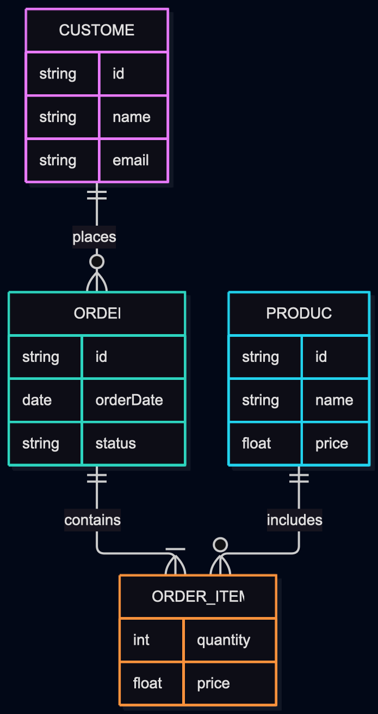

# DBMS_LAB-
# Experiment 1: E-Commerce Platform ER Modeling

## Problem Statement
Design an ER diagram for an Indian e-commerce platform with entities Customer, Product, Order, OrderItem, Seller, Category, Payment, Delivery, Address. Specify primary keys, composite and multi-valued attributes, weak entities, specialization of Product, and participation constraints.

## ER Diagram


## Key Concepts Mapped
- **Weak Entity**: `OrderItem` dependent on `Order` with partial key `item_no`.
- **Multivalued Attribute**: `Customer_Phone` associated with `Customer`.
- **Specialization**: `Product` generalized into `Electronics` and `Clothing`.
- **Composite Attributes**: Name (`first_name`, `last_name`), Address details (`street`, `city`, `state`, `pincode`).

## SQL Schema
```sql
-- See schema.sql for complete DDL definitions
```
